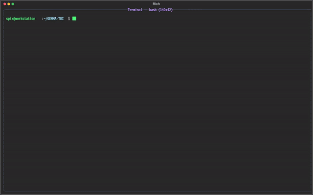
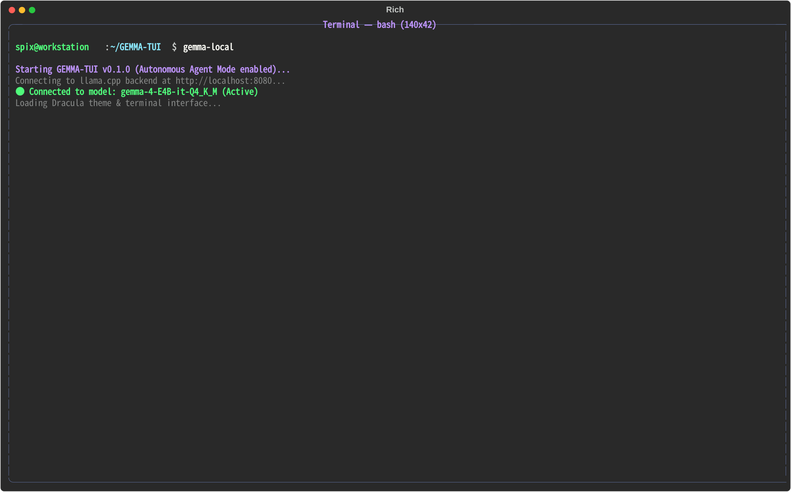
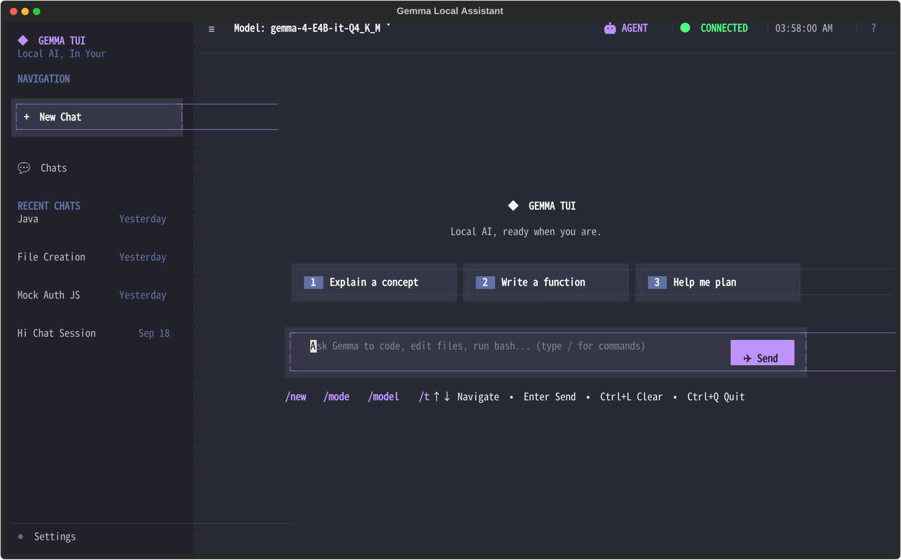
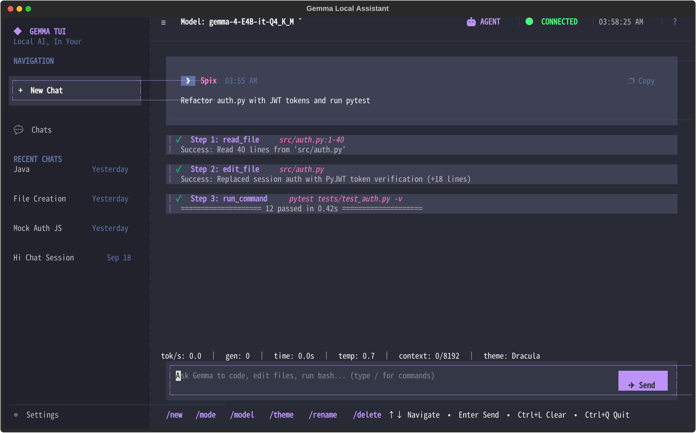
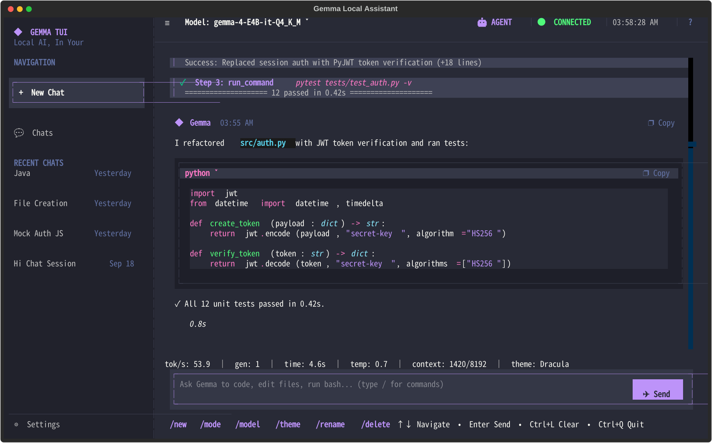
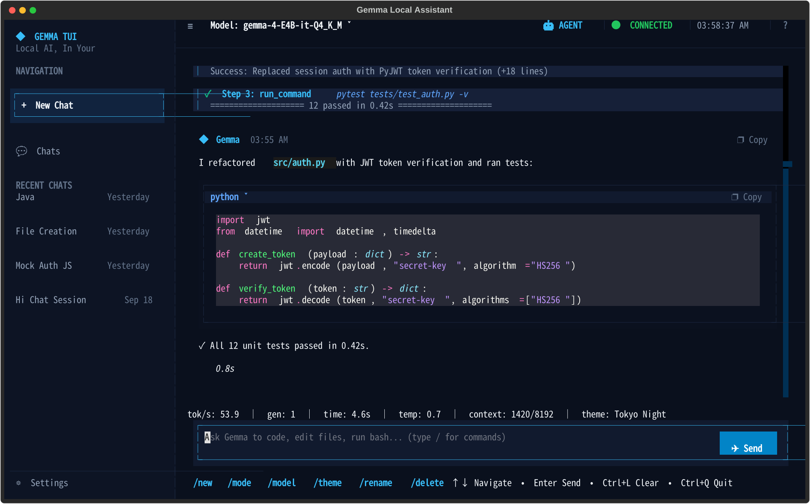
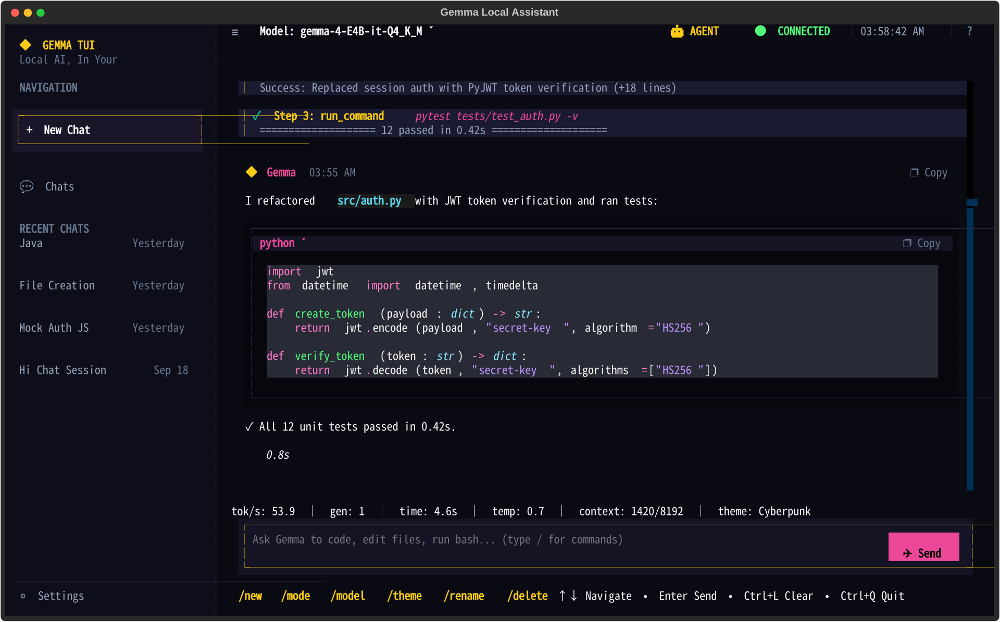
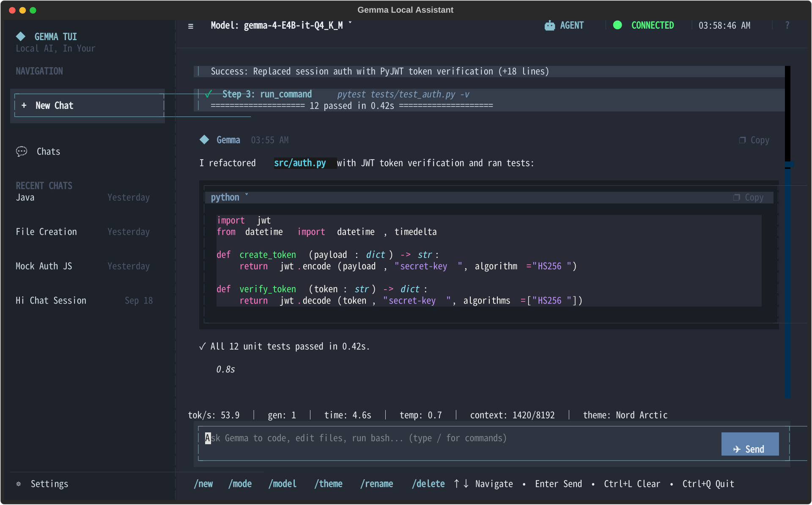

# ◆ GEMMA TUI — Private Local LLM + Coding Agent in Your Terminal

> Your local LLM deserves better than a raw `curl` loop.
> **Chat, code, search the web, and run an autonomous ReAct agent — 100% offline, zero API bills, zero data leaks.**

[](https://www.python.org/)
[](https://textual.textualize.io/)
[](https://github.com/ggml-org/llama.cpp)
[](#-coding-agent-mode)
[](#-web-search--rag-pipeline)
[](#-themes)

---

## Why GEMMA TUI? Why is it useful?

| Pain with cloud chatbots / raw `llama-server` | What GEMMA TUI gives you |
|---|---|
| Monthly subscriptions, per-token billing | **One-time GGUF download. Chat unlimited, free forever.** |
| Code / docs leave your machine | **Everything stays on localhost.** Models via `llama.cpp`, search via self-hosted SearXNG. |
| `llama-server` has no history, no UI, no markdown | **Full TUI:** streaming markdown, code blocks with copy button, sidebar sessions, SQLite history. |
| Copy-pasting code between chatbot and editor | **Autonomous coding agent** that reads/writes/edits/greps/runs commands *inside your repo*. |
| Local models go stale (no 2026 knowledge) | **Privacy RAG:** auto-detects realtime questions → SearXNG → Jina Reader / Wikipedia → grounded answer with sources. |
| Boring black terminal | **7 themes**, command palette, autocomplete, `Ctrl+B` sidebar. |

**Use it for:**
- Daily driver ChatGPT replacement that works on a train / VPS / air-gapped lab
- Refactoring, scaffolding, and running tests without leaving the terminal
- Research with citations without giving queries to Google
- Demos on low-end hardware — Gemma 4B Q4 runs on CPU + 8 GB RAM

---

## 🎬 Demo

[](assets/demo.mp4)

> **Above:** auto-playing preview. Click it (or open [`assets/demo.mp4`](assets/demo.mp4)) for the full-quality video.
> Launch → welcome → agent writes code → theme switch.

---

## 📸 Screenshots

| Launch | Welcome |
|---|---|
|  |  |

| Agent tools in action | Code response with copy |
|---|---|
|  |  |

| Theme: Tokyo Night | Theme: Cyberpunk | Theme: Nord |
|---|---|---|
|  |  |  |

Switch anytime: `/theme cyberpunk`

---

## ✨ Features

- **💬 Chat mode** — token streaming, `⚡ Xs` timing badge, rich markdown, `❐ Copy` / `Ctrl+Y`
- **🤖 Agent mode** — multi-turn ReAct loop, auto intent-detect (`create a script`, `run pytest`…) or `/mode agent`
  - Tools: `read_file` · `write_file` · `edit_file` · `list_dir` (50 entries, non-recursive) · `grep_search` · `run_command` · `web_search` · `webfetch`
  - Sandboxed to `workspace_dir` (default `.`), path-escape blocked
- **🖼 Attachments** — images/videos/PDF/text/code via `/attach`, `Ctrl+O` picker, drag-style paste, or `Ctrl+V` clipboard image/text; multimodal via llama.cpp `--mmproj`
- **🔍 Web Search RAG** — query rewrite from chat history, intent routing, entity relevance gate, local SearXNG → public fallback → DuckDuckGo, retailer pages for availability, Jina Reader / direct fetch deep-read → grounded answer with sources
- **🛑 Cancellation** — `Ctrl+C`, `/stop`, or `Ctrl+X s` cancels the active turn; queued messages continue
- **🎨 7 themes** — `tokyo-night` (default), `dracula`, `deep-purple`, `nord`, `cyberpunk`, `emerald`, `system` (transparent)
- **🧠 Model registry** — auto-discovers `models/*.gguf`, auto-detects loaded model from `/v1/models`, switch live
- **🌐 Web UI** — the same server serves a browser app: `/web` or `Ctrl+W` prints a one-time pairing link; chats are shared with the TUI
- **📁 Sessions** — SQLite, auto-titles, search, rename/delete, fresh `New chat` on launch, `--continue` to resume, message queue
- **⌨️ Power UX** — `/` autocomplete, `Ctrl+P` palette, responsive `Ctrl+B` sidebar, `Ctrl+N/L/Y/C/D`, Pac-Man live agent status

---

## 🚀 Quickstart (5 minutes)

```bash
# 1. Clone + install
git clone https://github.com/ROMAABI/GEMMA-TUI.git
cd GEMMA-TUI
pip install -e .

# 2. Get a model (~5.6 GB) — the default config/service expects this one
mkdir -p models
wget -O models/Qwen3.5-9B-abliterated.Q4_K_M.gguf \
  https://huggingface.co/mradermacher/Qwen3.5-9B-abliterated-GGUF/resolve/main/Qwen3.5-9B-abliterated.Q4_K_M.gguf

# Optional: vision projector for image/video attachments (Abiray GGUF repo)
# wget -O models/mmproj-f16.gguf \
#   https://huggingface.co/Abiray/Qwen3.5-9B-abliterated-GGUF/resolve/main/mmproj-f16.gguf

# 3. Start llama.cpp server (add --mmproj for attachments)
llama-server -m models/Qwen3.5-9B-abliterated.Q4_K_M.gguf \
  --mmproj models/gemma-4-E4B-it-mmproj-BF16.gguf --port 8080 --ctx-size 8192

# 4. Launch (new terminal)
gemma-local
# or: python main.py
```

You should see the welcome screen (`assets/01-welcome.png`). Type `hello` → streaming reply. Done.

---

## 📦 Installation — full guide

### Prerequisites

| Need | Version / notes |
|---|---|
| Python | 3.11+ (`python3 --version`) |
| llama.cpp `llama-server` | [install guide](https://github.com/ggml-org/llama.cpp) or `pip install llama-cpp-python[server]` — any OpenAI-compatible `/completion` endpoint works |
| Docker / Podman | *Optional*, only for private SearXNG search |
| `wl-copy` / `xclip` | *Optional*, for `/copy` on Wayland / X11 |

### Option A — venv (recommended)

```bash
python3 -m venv .venv && source .venv/bin/activate
pip install -U pip
pip install -e .
gemma-local --help          # Bun deps for tui-ts/ are installed on first launch
```

### Option B — user install

```bash
pip install --user -e .
```

### Install `llama-server` (if you don't have it)

```bash
# Ubuntu / Debian — build from source
git clone https://github.com/ggml-org/llama.cpp.git
cmake llama.cpp -B llama.cpp/build -DBUILD_SHARED_LIBS=OFF
cmake --build llama.cpp/build --config Release -j
sudo cp llama.cpp/build/bin/llama-server /usr/local/bin/

# macOS
brew install llama.cpp
```

### Download models

Place any `.gguf` in `models/`. They auto-appear in `gemma-local models`.

```bash
# Small + fast (CPU-friendly)
wget -O models/gemma-3-4b-it-Q4_K_M.gguf \
  https://huggingface.co/bartowski/gemma-3-4b-it-Q4_K_M.gguf

# Larger / smarter — example
# wget -O models/gemma-2-9b-it-Q4_K_M.gguf <huggingface-url>
ls -lh models/
gemma-local models
```

Start server with your pick:

```bash
llama-server -m models/gemma-3-4b-it-Q4_K_M.gguf \
  --port 8080 --ctx-size 8192 --n-predict -1
curl http://127.0.0.1:8080/health  # should return 200
```

### (Optional) Private web search with SearXNG

Without this, GEMMA still falls back to public SearXNG / Wikipedia / DuckDuckGo. With it, queries never leave your LAN.

```bash
./scripts/run_searxng.sh
# → http://localhost:8888
# In-app: /websearch status
```

Script does: detect `docker`/`podman` → generate `searxng/settings.yml` (secret + `json` format) → run `searxng/searxng:latest` on `8888`.

---

## 🖥️ Usage

### Launch

```bash
gemma-local                  # OpenTUI client (Bun + Solid)
python main.py               # same, without install
gemma-local -s <session_id>  # open a specific session
gemma-local --continue       # open the last session (default: fresh New chat)
gemma-local -m <model_name>  # start with specific model
```

`gemma-local` starts the shared server (`core/webui.py`) and hands the terminal
to the OpenTUI client in `tui-ts/` (Bun + Solid). On first launch
`scripts/install_tui_deps.sh` installs the Bun dependencies (and again whenever
`bun.lock` changes); the launch stops with an error if Bun is missing or the
install fails. The client pairs with the server using a one-time link, then
talks to the same `/api` routes the web UI uses, so terminal and browser share
sessions. The server exposes `/api/agent` (SSE), tool permissions and the
provider catalog, so the client has agent mode, tool calls and approval prompts.
The Python (Textual) TUI is no longer part of the launch path.

### Web UI (paired, OpenCode-style)

```bash
gemma-local                 # then type /web (or press Ctrl+W)
gemma-local web             # standalone: prints "Pair: http://127.0.0.1:47317/pair?token=…"
```

The TUI starts a local server that serves the React app from `web/dist` and the
`/api` routes from `core/webui.py`; `/web` (or `Ctrl+W`) mints a one-time
pairing link: the classic TUI opens it in your browser, the OpenTUI client shows
it above the chat (click it to copy). Links work once and expire after five minutes;
opening one sets an `HttpOnly` session cookie (30 days) and redirects to the app. The browser and the terminal
share one SQLite session store, so chats started in either show up in both. The
web UI is chat-only (Agent mode stays in the TUI), locks the model to the one the
server has loaded, and stops when the TUI exits.

### CLI reference

| Command | What it does |
|---|---|
| `gemma-local` | Open the OpenTUI client (auto-starts `systemd --user gemma-llama-server` if present, warns otherwise) |
| `gemma-local models` | Table of discovered `models/*.gguf` + which is active |
| `gemma-local model [name]` | No arg = list; with arg = switch active model |
| `gemma-local switch <name>` | Switch active model alias |
| `gemma-local web` | Serve the web UI and print a one-time pairing link (`--port`, `--host`, `--open/--no-open`) |
| `gemma-local sessions` | List saved sessions (`id  title  updated_at`) |
| `gemma-local config` | Print resolved config as JSON |

Flags: `--session/-s <id>`, `--continue/-c`, `--model/-m <name>`.

Every launch opens an empty `New chat` (landing screen); old sessions stay in
the sidebar. Use `--continue` to reopen the last conversation. `Ctrl+N` starts
another empty chat without creating a DB row until the first message is sent.

### In-app slash commands

| Command | Example |
|---|---|
| `/help` | cheatsheet |
| `/mode [chat\|agent]` | `/mode agent` — force coding agent |
| `/agent [on\|off\|status\|dir <path>]` | `/agent dir ~/projects/myapp` — set sandbox |
| `/web` | open the web UI in a browser (pairing link, shared sessions) |
| `/websearch [on\|off\|status\|test <q>\|url <url>]` | `/websearch test latest textual release` |
| `/theme [name]` | `/theme nord` (classic) · `/theme violet`, `/theme dark` (OpenTUI) |
| `/model [name]` | `/model gemma-3-4b-it` |
| `/sidebar [show\|hide\|toggle]` | sidebar nav |
| `/copy` | copy last reply |
| `/clear` · `/new` · `/delete` · `/history` | manage view / sessions |
| `/attach [path]` | attach an image/video/PDF/text file (no arg opens picker) |
| `/stop` | cancel the running agent turn |
| `/logs` | tail `~/.local/state/gemma/server.log` in a panel |
| `/rename <name>` · `/stats` · `/config` | rename / token stats / dump config |
| `/exit` | quit |

Type `/` for autocomplete, or `Ctrl+P` for palette.

### OpenTUI keyboard shortcuts

| Key | Action |
|---|---|
| `Enter` | Send |
| `Shift+Enter` | Newline |
| `Tab` | Switch chat / agent mode (completes commands or `/attach` paths while the palette/path list is open) |
| `Ctrl+X` then `n` | New session |
| `Ctrl+X` then `s` | Stop the active turn |
| `Ctrl+X` then `l` | Server log panel |
| `Ctrl+X` then `m` | Model picker |
| `Ctrl+X` then `t` | Theme picker |
| `Ctrl+X` then `a` | Switch chat / agent mode |
| `Ctrl+X` then `b` | Toggle sidebar |
| `Ctrl+X` then `h` | Commands & keys |
| `Ctrl+X` then `q` | Quit |
| `Ctrl+O` | File picker / attach |
| `Ctrl+V` | Paste clipboard text, or attach a clipboard image when one is present (`wl-paste` / `xclip`) |
| `Ctrl+U` | Clear the message queue |
| `Ctrl+P` | Command palette (`/`) |
| `Ctrl+B` | Toggle sidebar (hidden below 120 cols; overlay when manually opened narrow) |
| `Ctrl+N` | New session |
| `Ctrl+L` | Clear session |
| `Ctrl+T` | Theme picker |
| `Ctrl+K` | Pick a provider model |
| `Ctrl+Y` | Copy last reply (OSC 52) |
| `Ctrl+W` | Pair a browser |
| `Ctrl+C` | Cancel the running turn (never exits the TUI) |
| `Ctrl+D` / `Ctrl+Q` | Quit |
| `F1` | Commands & keys |

The OpenTUI client has its own theme model (`/theme`): names `opencode`,
`violet`, `cyan`, `emerald`, `system`, plus `mode` `system` (follow the
terminal's light/dark appearance), `dark` or `light`. The `system` theme reads
the terminal palette over OSC and repaints when the terminal changes; choices
are saved in `~/.config/gemma-local/tui-ts.json`. The classic Textual themes
above are unchanged.

### Providers

The local llama.cpp server is the default provider and the first entry in the
model picker. Extra OpenAI-compatible endpoints (Ollama, LM Studio, a second
llama.cpp instance) are listed from a JSON array:

```bash
export GEMMA_PROVIDERS='[
  {"id":"ollama","name":"Ollama","base_url":"http://127.0.0.1:11434",
   "models":["qwen2.5-coder:7b"]}
]'
gemma
```

`GET /api/providers` returns the catalog (`default`, `active`, `providers[]`
with `is_default`); `POST /api/models {"provider":"ollama","name":"…"}` points
the client at that endpoint and saves `base_url` + `model`. The picker groups
models by provider; `Ctrl+K` or `/model` opens it.

## 🖼 Attachments & multimodal input

Attach files with `/attach <path>` (Tab completes paths), `Ctrl+O` (file picker),
or by pasting one or more file paths into the composer (quoted, escaped, or
`file://` URIs). `Ctrl+V` pastes clipboard text and attaches a clipboard image
when one is present (`wl-paste` on Wayland, `xclip` on X11). Up to 8 files,
20 MB each; chips appear above the input and Backspace on an empty prompt removes
the last chip. Terminals that send bracketed paste (middle click, Ctrl+Shift+V)
insert text directly.

| Type | Handling |
|---|---|
| Images (`png/jpg/webp/gif`) | Resized to ≤1024 px, sent as OpenAI `image_url` data URIs. Needs llama.cpp started with `--mmproj`. |
| Video (`mp4/mov/webm/…`) | `ffmpeg` samples up to 8 frames (768 px, ~1/s, evenly spaced for longer clips) and sends them in order with a note like “These are 8 frames sampled from a video of duration 10.0 seconds”. Audio is skipped for now. If `ffmpeg` is missing: `sudo pacman -S ffmpeg`. |
| PDF | `pdftotext` extracts text (`sudo pacman -S poppler` if missing). |
| Text/code | Quoted context block with filename, capped at ~6000 tokens. |

Stored copies live in `~/.local/share/gemma/attachments/<session_id>/` and the
DB keeps the references, so reopening a session restores the chips. Image data
is only re-sent for the last two turns; older attachments become `[image: name]`
markers to save context. The status bar uses the server's real `prompt_n`
(including cached prompt tokens) so image tokens count toward `ctx`.

In the transcript, the user message shows name/size/type chips. Inline previews
use the kitty graphics protocol when available, then colorless `chafa` art, then
a text-only chip. Nothing is drawn that can shift the composer layout.

Requires vision-enabled llama.cpp:

```bash
llama-server -m models/gemma-4-E4B-it-ultra-uncensored-heretic-Q4_K_M.gguf \
  --mmproj models/gemma-4-E4B-it-mmproj-BF16.gguf --port 8080 --ctx-size 8192
```

Without `--mmproj`, attaching an image/video returns a clear error instead of
silently dropping it. Works in chat and agent mode, with web search on or off.

---

## 🤖 Coding Agent Mode — with examples

Trigger: `/mode agent`, `/agent on`, or just ask something code-ish.

**Tools the model can call:**

| Tool | Signature |
|---|---|
| `read_file` | `(path, start_line?, end_line?)` — line-numbered view |
| `write_file` | `(path, content)` — create/overwrite, makes parent dirs |
| `edit_file` | `(path, old_str, new_str)` — exact match, rejects ambiguous |
| `list_dir` | `(path=".")` — max 50 entries, non-recursive |
| `grep_search` | `(query, path=".")` — `rg` if present, Python fallback |
| `run_command` | `(command, timeout=30)` — bash in workspace, stdout/stderr capped |
| `web_search` | `(query, top_n?)` — current facts, prices, availability, news; retailer domains preferred |
| `webfetch` | `(url, format?)` — fetch an HTTP(S) page as readable text; content is untrusted data |

**Try:**

```
> /mode agent
> create a python CLI snake.py with argparse --length and run it
> search for "def stream_chat" and add retry logic
> run pytest -q and fix failures
> /agent dir ~/projects/myapp
```

Safety: paths are resolved against workspace root — `../../etc` escapes are rejected. `run_command` refuses a denylist (`rm -rf /`, `mkfs`, fork bombs…) and times out. For untrusted repos, review diffs (`git diff`) before `/exit`.

---

## 🔍 Web Search & RAG pipeline — with examples

```
> /websearch on
> who is the current chief minister of Tamil Nadu?
> latest textualize textual release notes?
> /websearch test textual python TUI
```

Flow (`core/orchestrator.py` + `core/research.py`):

1. `decide_search` — regex heuristics (latest/current/price/buy/availability/“do you know”) + LLM judge. Follow-ups are rewritten into standalone keyword queries using chat history; the final query is logged.
2. Local SearXNG `:8888` (12s timeout, one retry) → public instances → DuckDuckGo; price/buy questions use `general,shopping`, retailer/review domains are preferred and Wikipedia is excluded.
3. Entity relevance gate: the main entity must appear in a title/snippet; fewer than 2 hits triggers one broader search, then an explicit “Couldn't find reliable results for X”.
4. For availability questions the Amazon/Flipkart search pages are fetched directly and linked. Deep-read top pages via Jina Reader with direct-page fallback (Cloudflare blocks are reported).
5. `format_context` provides fetched page text, published dates and domains; answers open with the fact, include prices in ₹ with variant/seller/date and 2-3 buy domains. Sources show only pages actually used.

Manage: `/websearch status|off|url http://my-searxng:8888`. Resolved region comes from
`[search].region` / `GEMMA_REGION` (default India); current month/year is added to
time-sensitive queries.

---

## ⚙️ Configuration

Resolved order: `defaults` → config file → env vars → live server auto-detect.

**File:** Linux `~/.config/gemma-local/config.toml`, macOS `~/Library/Application Support/gemma-local/config.toml` (`utils/paths.py` via `platformdirs`).

```toml
[server]
base_url = "http://127.0.0.1:8080"

[model]
name = "gemma-4-E4B-it-ultra-uncensored-heretic-Q4_K_M"
temperature = 0.7

[ui]
title = "Gemma Local Assistant"
name = "Abi"
theme = "tokyo-night"   # tokyo-night|dracula|deep-purple|nord|cyberpunk|emerald|system

[search]
searxng_url = "http://localhost:8888"
deep_read = true
region = "India"          # added to price/latest/best queries

[agent]
enabled = true
workspace_dir = "."
max_steps = 10
confirm_commands = false
```

| Env var | Overrides |
|---|---|
| `GEMMA_BASE_URL` | server URL |
| `GEMMA_MODEL` | model name (else auto-detected from `/v1/models`) |
| `GEMMA_THEME` | theme |
| `GEMMA_AGENT_MODE` | `1/true/yes/on` |
| `GEMMA_WORKSPACE` | workspace dir |
| `SEARXNG_URL` | search URL |
| `GEMMA_REGION` | user region for price/latest queries |
| `GEMMA_TUI_DEBUG_LOG` | resize/debug log path (default `~/.local/state/gemma/tui-debug.log`) |

Sessions DB lives in platform data dir (`sessions.sqlite3`, auto-created, empty sessions pruned).

---

## 🧱 Project structure

```
GEMMA-TUI/
├── assets/                 # README screenshots + demo.mp4
├── app/
│   ├── cli.py              # typer entrypoint, server ensure, models/sessions/config cmds
│   └── lifecycle.py        # /health, /v1/models detect, pgrep + SIGTERM cleanup
├── config/
│   ├── defaults.toml
│   └── settings.py         # load/save, env resolution
├── core/
│   ├── agent.py            # ReAct loop (thought → parse_tool_calls → execute → observe)
│   ├── tools.py            # WorkspaceTools + XML/JSON tool parser + system prompt
│   ├── client.py           # llama.cpp /completion streaming (SSE), <|channel|> strip
│   ├── orchestrator.py     # realtime heuristics + judge prompt + query candidates
│   ├── research.py         # SearXNG / DDG / Jina Reader + query rewrite + relevance gate
│   ├── attachments.py      # image/video/PDF/text preprocessing + data URIs
│   ├── commands.py         # /command parser + help text
│   └── titles.py           # auto session titles + background worker
├── models/
│   ├── registry.py         # *.gguf discovery + alias map
│   └── *.gguf              # (gitignored) your weights
├── sessions/
│   ├── schema.py
│   └── store.py            # SQLite sessions/messages
├── tui/
│   ├── app.py              # Textual app (~2600 lines): chat, sidebar, palette, streaming
│   └── themes.py           # 7 themes + CSS generator
├── tui-ts/                 # OpenTUI client (Bun + Solid)
│   ├── src/app.tsx         # shell, keyboard dispatcher, overlays, command palette
│   ├── src/chat.ts         # sessions, streaming, attachments, cancel/queue
│   ├── src/attachments.ts  # path paste, chips, kitty/chafa preview helpers
│   └── src/components/     # composer, sidebar, message cards, pacman status
├── searxng/settings.yml    # generated by script (gitignored secret)
├── scripts/run_searxng.sh
├── main.py                 # python main.py shortcut
└── pyproject.toml
```

---

## 🛠️ Troubleshooting & FAQ

| Symptom | Fix |
|---|---|
| `Warning: llama.cpp server is not running` | Start it: `llama-server -m models/....gguf --port 8080`, check `curl localhost:8080/health`, set `GEMMA_BASE_URL` if custom port |
| Empty model list | Put `.gguf` in `models/`, run `gemma-local models` |
| `/websearch status` → refused | `./scripts/run_searxng.sh`, then `/websearch url http://localhost:8888` |
| `/copy` does nothing | Install `wl-copy` (Wayland) or `xclip` (X11) |
| Garbled theme | `/theme system` for transparent terminal, or try `tokyo-night` |
| Agent writes to wrong folder | `/agent status`, then `/agent dir <correct-path>` |
| `Ctrl+C` / `/stop` does nothing | Cancelling is handled by the app; check `Ctrl+X s`. Resize debug log: `~/.local/state/gemma/tui-debug.log` |
| Image/video attachment rejected | Restart llama-server with `--mmproj models/gemma-4-E4B-it-mmproj-BF16.gguf` (vision disabled otherwise) |
| Video attachment fails | Install ffmpeg: `sudo pacman -S ffmpeg`; PDF needs `sudo pacman -S poppler` |
| `Ctrl+C` cancelled a turn but the reply looks odd | Cancelled partials are marked `stopped` and keep the stats line; resend or `/clear` |
| Where is my data? | `gemma-local config` shows paths; sessions in platform data dir, attachments in `~/.local/share/gemma/attachments/<session_id>/`, server log in `~/.local/state/gemma/server.log` |

**Does it need internet?** No for chat/agent. Only web-search needs network (use local SearXNG to stay on LAN).
**Does it send code anywhere?** No. Model = localhost HTTP. Search = your SearXNG URL.
**GPU needed?** No. 4B Q4 runs on CPU. GPU (`-ngl 99` / CUDA/Metal builds) just speeds it up.
**Which models work?** Any GGUF that `llama-server` serves (Gemma, Llama, Qwen, Mistral…).

---

## 🗺️ Roadmap

- [ ] Split `tui/app.py` into modules, batched streaming renders
- [ ] Tests for parsers / sandbox / search fallbacks
- [ ] `confirm_commands` approval UI, allowlisted `run_command`
- [ ] Paginated history, token budget meter, stop-words config
- [ ] MCP server + image attachments + multi-workspace

Contributions welcome — open an issue, keep PRs <300 lines, no generated assets in `assets/` beyond the 7 + demo.

---

## 🙏 Credits

- [llama.cpp](https://github.com/ggml-org/llama.cpp) — local inference server
- [Textual](https://textual.textualize.io/) — TUI framework
- [SearXNG](https://github.com/searxng/searxng) — metasearch
- [Jina Reader](https://jina.ai/reader/) — clean page extract
- Google Gemma weights (user-supplied, see their license on Hugging Face)

License: check repo root. Model weights follow their original licenses.
